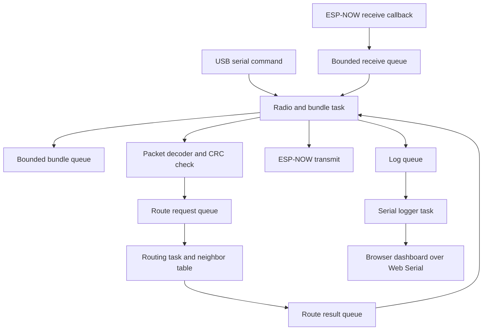

# Aegis Code Walkthrough and Design Rationale

This document explains the implementation in this repository: how a node starts, discovers peers, chooses a route, queues and forwards bundles, and exposes those events through the browser dashboard. It also explains why the code uses its current approaches and what alternatives would change.

The repository is an ESP32 prototype. The current route scorer is a small hand-weighted integer model, not a model trained from a dataset. The bundle queue is held in RAM, and ESP-NOW peers and packet contents are not authenticated or encrypted. These boundaries matter when interpreting results.

## Contents

1. [Architecture at a glance](#1-architecture-at-a-glance)
2. [Files and responsibilities](#2-files-and-responsibilities)
3. [Boot and task flow](#3-boot-and-task-flow)
4. [Scheduled work](#4-scheduled-work-in-srcmaincpp)
5. [Functions in `main.cpp`](#5-functions-in-srcmaincpp)
6. [Packet format and codec](#6-packet-format-and-codec)
7. [ESP-NOW transport](#7-esp-now-transport)
8. [Bundle queue and retry behavior](#8-bundle-queue-and-retry-behavior)
9. [Routing and RSSI-first next-hop policy](#9-routing-table-and-rssi-first-next-hop-policy)
10. [Weak-signal simulation](#10-simulating-a-weak-signal)
11. [Browser dashboard](#11-browser-dashboard)
12. [Configuration and build](#12-configuration-and-build-environments)
13. [Design choices and alternatives](#13-design-decisions-and-alternatives)
14. [Current limits](#14-current-limits-and-safe-interpretation)

## 1. Architecture at a glance



The radio callback only copies a received frame into a fixed-size queue. The radio/bundle task drains that queue, validates packets, updates the route worker, accepts bundles, and schedules forwarding. The route worker owns its routing table; the logger task owns normal serial output. This keeps route-table updates and serial writes out of the ESP-NOW callback.

## 2. Files and responsibilities

| File | Responsibility |
| --- | --- |
| `src/main.cpp` | Startup, FreeRTOS tasks, serial commands, beacon and bundle lifecycle, scheduling, and status logs. |
| `include/aegis/Config.hpp` | Node identity, radio channel, timeouts, queue capacities, and frame limits. |
| `include/aegis/Protocol.hpp`, `src/Protocol.cpp` | Packet types, explicit packet serialization, validation, and CRC-16. |
| `include/aegis/EspNowTransport.hpp`, `src/EspNowTransport.cpp` | ESP-NOW setup, receive callback, frame queue, MAC-to-node peer mapping, and sends. |
| `include/aegis/Routing.hpp`, `src/Routing.cpp` | Neighbor table, freshness, hop-count routing, and the tiny integer route scorer. |
| `include/aegis/BundleQueue.hpp`, `src/BundleQueue.cpp` | Fixed-capacity RAM queue, priority order, acknowledgement wait, retry eligibility, and eviction. |
| `dashboard/index.html` | Browser UI that reads serial event lines and can send the existing serial `send` command. |
| `platformio.ini` | Five build environments, one per compile-time node ID. |
| `scripts/xtensa_toolchain.py` | Adds the PlatformIO ESP32 compiler's nested directory to the build path. |
| `docs/PROTOCOL.md` | Concise wire-format reference. |
| `docs/QUICKSTART.md` | Build, flash, serial commands, dashboard, and first-run procedure. |

## 3. Boot and task flow

`setup()` starts Serial, prints the configured node and channel, and calls `EspNowTransport::begin()`. If radio initialization fails, it reports a boot error and returns. It then creates three FreeRTOS queues: a 24-record log queue, a 16-entry route request queue, and a 4-entry route result queue. The transport creates its own 8-frame receive queue.

After the queues exist, `setup()` pins three tasks:

| Task | Core / priority / stack | Work |
| --- | --- | --- |
| `aegis_host_logger` | Core 1 / 1 / 3072 bytes | Takes bounded log records from `logQueue` and writes them to Serial. |
| `aegis_router` | Core 1 / 2 / 4096 bytes | Owns `RoutingTable`; applies updates and answers cost/next-hop requests. |
| `aegis_radio_bundle` | Core 0 / 3 / 6144 bytes | Runs the serial, receive, beacon, forwarding, and status jobs. |

The Arduino `loop()` blocks indefinitely because ongoing work belongs to the FreeRTOS tasks. If any queue or task cannot be created, startup prints an error. The radio is initialized before the queues and worker tasks; the receive callback checks whether its queue is available before enqueueing a frame.

### Why three tasks and queues?

ESP-NOW callbacks should do very little work. The callback copies bytes and RSSI and attempts a non-blocking queue send; parsing, route selection, and printing happen later. Separate route-table ownership also avoids unsynchronized reads and writes to `RoutingTable`.

An alternative would be a single-threaded `loop()` implementation. That would use fewer queues and be easier to trace, but long serial output or packet processing could delay radio housekeeping. Another alternative would put routing behind a mutex. A single owning router task and request/result queues make the ownership boundary explicit, at the cost of queue storage and a bounded wait for route answers.

## 4. Scheduled work in `main.cpp`

`radioBundleTask()` initializes the job clocks at task startup, assigns each node ID a beacon phase offset to reduce synchronized broadcasts, then repeatedly calls `runScheduledJobs(millis())` and yields for one millisecond. `runScheduledJobs()` compares elapsed unsigned time with each job's interval. The subtraction form (`now - lastRun`) remains valid across the normal `millis()` wraparound.

| Job | Interval | Purpose |
| --- | ---: | --- |
| `processSerial` | 1 ms | Collect a newline-terminated command and dispatch it. |
| `processFrames` | 1 ms | Drain queued ESP-NOW frames and process packets. |
| `sendBeacon` | 400 ms | Broadcast the next destination's route cost and queue occupancy. It cycles through five targets, so each target is refreshed every two seconds. Each node has a startup phase offset to reduce collisions between synchronized beacons. |
| `processForwarding` | 10 ms | Send one due queued bundle, if a route is available. |
| `runStatus` | 10000 ms | Print counters, queue state, route cost, and free heap. |

This is cooperative scheduling inside one task: one job runs at a time, and forwarding processes at most one bundle per invocation. A timer-driven task per job would give stronger isolation, but would add scheduling complexity and more stack allocations. A single blocking loop would be simpler but could miss regular work while waiting on serial or a peer.

## 5. Functions in `src/main.cpp`

### Logging and worker tasks

| Function | What it does and how |
| --- | --- |
| `logBytes(bytes, length)` | Copies at most 256 bytes into a `LogRecord` and enqueues it. Before `logQueue` exists, it writes directly to Serial. It is used for arbitrary payload bytes. |
| `logLine(line)` | Copies a bounded string, appends a newline, and queues or directly writes it. Queue-full log records are dropped rather than blocking radio work. |
| `logPrintf(format, ...)` | Formats one line into a 256-byte local buffer, then calls `logLine`. |
| `loggerTask()` | Waits on `logQueue` and writes each record to Serial. It keeps ordinary diagnostic I/O away from the radio job path. |
| `routingTask()` | Blocks on `routeQueue`. `Update` messages mutate its local `RoutingTable`; cost and next-hop messages produce a `RouteResult`. Tiny route selection is chosen only when the request operation is `NextHopTinyMl`. |
| `requestRoute(request)` | Assigns a request ID, enqueues the request, and waits up to 50 ms for the matching result. It returns `0xFF` when the queue is unavailable/full or the answer times out. The timeout prevents a stalled router from blocking the radio task indefinitely. |
| `routeCost(destinationId, nowMs)` | Wraps a `Cost` request. `0xFF` represents an unknown route. |
| `routeNextHop(destinationId, visitedMask, nowMs, requireRelay)` | Chooses `NextHopTinyMl` when `tinyMlEnabled` is true, otherwise the deterministic baseline. The source sets `requireRelay` for its first send, which excludes the destination itself. It maps a failed request (`0xFF`) to node ID zero, meaning no route. |

### Duplicate tracking and transmission

| Function | What it does and how |
| --- | --- |
| `wasSeen(bundleId)` | Scans the fixed 16-entry recent-ID array and reports whether the bundle is already known. |
| `remember(bundleId)` | Adds an ID at the circular cursor and advances it. Old entries are replaced after the array wraps. |
| `forget(bundleId)` | Clears matching entries when a queued bundle is evicted or expires, allowing a later retransmission to be accepted. |
| `transmit(packet, broadcast, peerNodeId)` | Encodes a `Packet` into a stack buffer, then calls broadcast or peer send. It increments `transmitted` when the transport API accepts the send. This counter means accepted by the local ESP-NOW API, not confirmed delivery. |
| `sendAck(destinationId, bundleId)` | Builds an ACK addressed to the immediately preceding hop, with the stable bundle ID, then sends it unicast. In this prototype an ACK confirms that this hop accepted the bundle, not end-to-end delivery to the final destination. |
| `sendBeacon(nowMs)` | Creates a 3-byte beacon payload for the next destination ID in a 1–5 rotation: current route cost to that destination, queue occupancy percent, and free queue slots. It sends one beacon every 400 ms, refreshing each destination every two seconds. |

### Incoming frames and bundle handling

| Function | What it does and how |
| --- | --- |
| `processBeacon(packet, frame, nowMs)` | Checks beacon payload size and origin/last-hop consistency; treats the header destination ID as the route being advertised; maps the node ID to the received MAC; applies a configured simulated RSSI override if present; and enqueues that destination's route update. |
| `processAck(packet)` | Rejects ACKs not addressed to this node or with a payload. A matching bundle ID removes the local copy from `BundleQueue` and logs the acknowledgement. |
| `processBundle(packet, nowMs)` | Rejects empty/expired bundles; re-ACKs duplicates; delivers and ACKs a bundle addressed here; rejects loops or exhausted hop limits; otherwise stores it in the queue before acknowledging the sender. If storage evicts a lower-priority bundle, its duplicate-cache entry is cleared. |
| `processFrames(nowMs)` | Drains the transport receive queue. It decodes and CRC-checks every frame, counts valid packets, ignores packets whose last hop is this node, then dispatches beacon, bundle, or ACK processing. Bundle and ACK senders are registered as ESP-NOW peers using their observed MAC. |
| `processForwarding(nowMs)` | Gets one due queue entry, checks its local queue-age TTL and hop limit, asks for a next hop, and requires a relay when the bundle origin is this node. If none exists it defers for one second and logs `bundle_waiting_route`. Otherwise it copies the packet, updates last hop, hop limit, visited mask, sequence, and remaining TTL, then sends. A successful local send starts ACK waiting; a local send error defers for 500 ms and logs `bundle_send_failed`. |
| `printStatus(nowMs)` | Emits a machine-readable line with node, example/default destination, queue, occupancy, default route cost, route costs to all five node IDs, model mode, counters, and free heap. |
| `runStatus(nowMs)` | Scheduled wrapper around `printStatus`. |

The local data structures support those functions. `Counters` holds receive, transmit, malformed, retry, delivery, and drop totals. `RouteMessage` transports either a neighbor update or a query, including the timestamp, visited mask, and first-hop relay flag needed by the router; `RouteResult` carries the request ID and one-byte result back. `LogRecord` owns a bounded 256-byte copy so queued log messages do not point to temporary stack buffers. Each `ScheduledJob` pairs a callback with its interval and last-run time.

The bundle sequence is store, acknowledge the local hop, then forward and wait for the next hop's ACK. That keeps a relay responsible for a bundle after it acknowledges it. The storage is RAM-only, so reset or power loss discards queued data.

### Serial command functions

| Function | What it does and how |
| --- | --- |
| `parsePriority(text, priority)` | Converts `critical`, `normal`, or `bulk` into the corresponding enum. Unknown text is rejected. |
| `handleSendCommand(command)` | Parses `send <destination> <priority> <message>`, validates destination and payload length, assigns a bundle ID using node ID, random bits, and sequence, sets initial TTL/hop limit/visited mask, and enqueues the bundle. |
| `handleSimulationCommand(command)` | Parses `sim rssi <peer> <-110..-20|auto>`. A numeric value sets a per-peer RSSI override; `auto` restores measured RSSI. The override is used on this node only when processing peer beacons. |
| `processSerial(nowMs)` | Reads available characters into a fixed 256-byte line buffer. At newline it dispatches `send`, `status`, `model on`, `model off`, `sim rssi`, or `help`; other non-empty lines produce an error. |
| `setup()` | Performs serial and radio startup, creates queues and tasks, and prints the available commands. |
| `loop()` | Sleeps indefinitely; task work is handled by FreeRTOS. |

## 6. Packet format and codec

`Packet` is the in-memory representation. It is never copied directly onto the radio: `encodePacket()` writes each field explicitly, and `decodePacket()` reads each field explicitly. This makes field sizes and little-endian byte order independent of compiler padding and alignment.

The current wire layout is a 29-byte header, up to 200 payload bytes, and a 2-byte CRC. The packet carries a magic value, protocol version, type, origin and last-hop IDs, destination, priority, hop budget, sequence, stable bundle ID, TTL, visited-node mask, and payload length. The CRC is CRC-16/CCITT-FALSE (initial value `0xFFFF`, polynomial `0x1021`) over the bytes before the CRC.

### Codec helper functions

| Function | Responsibility |
| --- | --- |
| `writeU16`, `writeU32`, `writeU64` | Append fixed-width integers one byte at a time in little-endian order. |
| `readU16`, `readU32`, `readU64` | Reconstruct little-endian integers while advancing the input offset. |
| `crc16(data, length)` | Compute the accidental-corruption check used by both encode and decode. |
| `validNode(nodeId)` | Accept only node IDs 1 through 5. |
| `nodeMask(nodeId)` | Map node ID `n` to bit `n - 1`; invalid IDs map to zero. This mask records visited nodes and blocks routing loops. |
| `encodePacket(packet, output, capacity, outputLength)` | Validates size and IDs, writes header and payload, appends CRC, and returns false if any bound or identity check fails. |
| `decodePacket(input, inputLength, packet)` | Validates frame bounds, magic, version, frame type, IDs, priority, payload length, exact frame size, and CRC before copying the decoded result to the caller. |

The codec validates common fields; type-specific checks live in `main.cpp`. For example, `processBeacon()` expects exactly three payload bytes, while `processAck()` expects none. A CRC catches accidental corruption, but it does not authenticate the sender or prevent replay. A packed C++ struct would be shorter to write but would expose compiler layout and endianness differences. A JSON payload would be easier to inspect but would consume more bytes and parsing memory on a 250-byte radio frame.

See [`PROTOCOL.md`](PROTOCOL.md) for the byte-by-byte table.

## 7. ESP-NOW transport

`EspNowTransport::begin(channel)` creates the 8-frame receive queue, starts station mode, disables Wi-Fi sleep, selects the channel, initializes ESP-NOW, adds the broadcast peer, and registers the receive callback. Failure unwinds the queue and radio initialization where possible.

| Function | Responsibility |
| --- | --- |
| `EspNowTransport::receive(frame)` | Non-blocking read from the callback's bounded queue. |
| `sendBroadcast(data, length)` | Validates pointer and frame size, then sends to the all-FF broadcast MAC. |
| `sendToNode(nodeId, data, length)` | Looks up the previously learned MAC for the node ID, then sends unicast. |
| `registerPeer(nodeId, mac)` | Stores the node-to-MAC mapping in a fixed table and adds the MAC to ESP-NOW if it is not already a peer. |
| `macForNode(nodeId, mac)` | Copies a known MAC into the output buffer. |
| `addMacAsPeer(mac)` | Adds an unencrypted station-interface ESP-NOW peer on the configured channel. |
| `onReceive(info, data, length)` | Rejects invalid/oversized frames, copies MAC/RSSI/data into `ReceivedFrame`, and attempts a zero-wait queue send. It does not decode, route, or log. |

The transport learns peer MAC addresses from received beacons and packets because the application routes by small node IDs, while ESP-NOW sends by MAC address. A static MAC table would avoid learning, but would make each board require per-device configuration. Wi-Fi sockets, MQTT, or an access point would suit an IP network, but the initial testbed uses ESP-NOW so it can operate without an access point.

## 8. Bundle queue and retry behavior

`BundleQueue` contains exactly `kQueueCapacity` (8) entries in a fixed array. No dynamic allocation occurs for bundle storage.

| Function | Responsibility |
| --- | --- |
| `priorityRank(priority)` | Uses the enum values `bulk=0`, `normal=1`, `critical=2` for ordering. |
| `reached(nowMs, deadlineMs)` | Uses signed wrap-safe subtraction to decide whether a due time has passed. |
| `enqueue(packet, nowMs, evictedLowerPriority, evictedBundleId)` | Uses a free slot when possible. If full, finds the oldest entry among the lowest priority and only replaces it when the new packet has strictly higher priority. |
| `nextDue(nowMs, bundle, slotIndex)` | Skips entries whose defer time has not arrived or whose ACK timeout has not elapsed; selects the highest-priority due entry, then the oldest. |
| `markSent(slotIndex, nowMs)` | Marks the entry as awaiting ACK, records send time, and increments retry count up to five. The count saturates; TTL bounds queue lifetime, but there is no separate terminal max-retry drop. |
| `defer(slotIndex, nowMs, delayMs)` | Clears ACK-wait state and schedules another attempt after a local send failure or route absence. |
| `acknowledge(bundleId)` | Clears the matching entry and decrements queue size. |
| `size()` | Returns the number of occupied entries. |
| `bufferPercent()` | Converts occupied entries to percent of queue capacity. |

A FIFO queue is a simpler alternative, but it cannot favor critical traffic when capacity is scarce. A heap could make selection faster, but with eight entries the fixed scan is simpler and bounded. Flash/NVS or SD storage would survive resets, but adds wear, latency, and storage-failure handling; persistent DTN storage is a later extension.

## 9. Routing table and RSSI-first next-hop policy

Each `Neighbor` stores node ID, an advertised cost and update timestamp for every destination ID, buffer percent, RSSI, last-heard time, and occupied state. A peer's direct link expires after seven seconds without any beacon. Each destination advertisement has its own seven-second freshness timer, so losing one target's beacon does not keep a stale cost alive just because other target beacons from that peer continue arriving. Nodes send one of the five target beacons every 400 ms; each target refreshes every two seconds.

| Function | Responsibility |
| --- | --- |
| `isFresh(neighbor, nowMs)` | Requires an occupied entry whose age is no greater than `kNeighborTimeoutMs`. |
| `RoutingTable::update(...)` | Validates IDs and buffer range, updates only the destination entry from this beacon while retaining the peer's other advertised routes, or allocates/reuses a neighbor slot when this peer is new. |
| `costTo(destinationId, nowMs)` | Returns zero for self, one when the destination is a live direct neighbor, otherwise one plus the best fresh per-destination neighbor-advertised cost; returns `0xFF` for unknown. |
| `nextHop(destinationId, visitedMask, nowMs, requireRelay)` | Filters to fresh, unvisited neighbors that are the destination or advertise a fresh route to it. It ranks strongest RSSI first, then lower route cost, then lower node ID. When `requireRelay` is true, it excludes the destination candidate. |
| `nextHopTinyMl(destinationId, visitedMask, nowMs, selectedScore, requireRelay)` | Uses the same candidate and first-hop relay rules. Strongest RSSI is always primary; its integer score ranks route cost and buffer occupancy only when RSSI values tie. |
| `freeSlots(nowMs)` | Counts fresh occupied neighbors. The current beacon uses queue slots from `BundleQueue` rather than this helper. |
| `neighbor(nodeId, nowMs)` | Returns a pointer to a fresh neighbor record, or null. |

The default mode's tie-break score is:

```text
tie_score = 160 - 100 * advertised_cost - buffer_percent
```

Among eligible candidates, the highest RSSI always wins. The score above is considered only for equal RSSI, then the lower node ID resolves an exact tie. This keeps inference to integer arithmetic and makes route cost and buffer use secondary criteria. It is a hand-set tie-breaker, not a model trained from data. `selectedScore` is produced by the routing method but the caller does not log it; the actual selected node is visible in each `bundle_forwarded next=...` event.

`model on` is the default and applies the integer tie-break score. `model off` keeps the same strongest-RSSI priority but breaks RSSI ties by route cost and node ID. The source requires a relay for its first forwarding attempt; subsequent relays may choose the destination when it is the strongest eligible neighbor. The visited mask prevents a packet from choosing a node it has already traversed. A trained quantized model, a decision tree, TensorFlow Lite Micro, or a host-computed policy could replace the tie-breaker, but must preserve the strongest-RSSI and first-relay requirements if those remain experiment constraints.

Each beacon advertises one destination so the existing compact wire format remains unchanged. A single vector beacon containing all five costs would reduce broadcast count, but would change the beacon payload format and require versioned compatibility handling. Cycling is a reasonable trade-off for this five-node testbed: each node sends 2.5 small broadcasts per second, spreads its schedule by node ID, and refreshes every destination route every two seconds.

## 10. Simulating a weak signal

`simulatedRssi[]` stores one override per peer; `-128` means use the measurement from the received ESP-NOW frame. `handleSimulationCommand()` changes the value. `processBeacon()` substitutes it only when creating the local `RouteMessage`, so the routing table and `event=neighbor` line see the simulated RSSI.

Example from Node 1's serial connection:

```text
sim rssi 2 -95
status
send 5 normal low-signal-check
sim rssi 2 auto
```

This is a feature-level simulation: it tests whether RSSI affects route selection. It does not attenuate RF, increase retries, drop packets, change delivery probability, or alter the peer's own estimate of Node 1. To simulate real loss, add a controlled packet-drop/delay layer or use distance, shielding, or RF attenuation. The software override is repeatable and easy to reset; physical attenuation tests the radio rather than only the decision logic.

## 11. Browser dashboard

`dashboard/index.html` is a self-contained page. It does not run a server-side transport; it uses browser Web Serial to read and write the USB serial stream at 115200 baud.

| Dashboard function | Responsibility |
| --- | --- |
| `eventLine(line)` | Parses `key=value` fields from firmware log lines, updates node and directed-link observations, adds bundle activity events, bounds event history, and calls `render()`. |
| `updateHopTrace(fields, stamp)` | Groups bundle lifecycle events by bundle ID, records each unique forwarding edge and repeated send attempts, and updates the visible delivery/waiting state. |
| `render()` | Rebuilds node, neighbor, traffic, next-hop trace, and log views; expires old observations; fills source/destination controls; and enables sending when a connected source exists. |
| Connect button handler | Requests a browser serial port, opens it, pipes decoded text into newline-delimited events, associates the stream with a node ID, and cleans up reader/writer/port locks on exit. |
| Send form handler | Validates distinct source/destination and non-empty message, then writes the existing firmware command `send <destination> <priority> <message>`. |
| Clear button handler | Clears displayed event, traffic, and hop-trace history. It does not change node state or firmware queues. |
| `setInterval(render, 1000)` | Refreshes stale/online indicators once per second. |

The dashboard escapes dynamic strings before placing them into HTML. It marks a node as serial-connected while its stream is alive and retains radio links for six seconds without a beacon. The firmware considers a route fresh for seven seconds; these are display and routing thresholds, respectively. Web Serial availability depends on browser support and a secure context such as localhost. A native app or server-side serial bridge would support more browsers, but would require an additional component and deployment steps.

## 12. Configuration and build environments

`Config.hpp` centralizes five-node identity limits, Node 5 as example/default status target, channel 6, a two-second full destination-refresh period split into 400 ms beacon intervals, seven-second neighbor and advertisement expiry, 1200 ms ACK timeout, one-hour bundle TTL, eight-hop budget, bounded queue capacities, and 200-byte payload/250-byte frame limits. `static_assert` checks that the configured maximum payload fits the ESP-NOW v1 frame budget.

`platformio.ini` defines `node1` through `node5`; each environment sets `AEGIS_NODE_ID` while sharing board, Arduino framework, upload speed, and compiler flags. This creates five firmware images from one codebase. An alternative is to assign IDs at runtime from a provisioning interface, which makes flashing simpler but requires collision checks and persistent identity storage.

The post-build script `scripts/xtensa_toolchain.py` finds the platform's Xtensa toolchain package and prepends the actual nested compiler directory to the PlatformIO build PATH. It adapts to the package layout expected by this pinned platform. Pinning a platform package improves reproducibility; a fully locked dependency manifest would further capture package versions.

## 13. Design decisions and alternatives

| Current choice | Why it fits this prototype | Alternative and trade-off |
| --- | --- | --- |
| ESP-NOW broadcast beacons and direct unicast | No access point is needed; observed MACs are learned dynamically. | Wi-Fi sockets/MQTT provide familiar IP tools but require an access point or configured mesh. |
| Explicit byte serialization and CRC | Bounded, portable field layout; detects accidental corruption. | Raw C++ structs are shorter to implement but can vary by compiler; JSON is readable but larger. Authentication/encryption is a separate future security decision. |
| Fixed arrays and bounded FreeRTOS queues | Predictable RAM use and bounded work on the ESP32. | Heap-backed containers are more flexible but risk fragmentation and unbounded allocation. |
| Store-and-forward bundle queue with hop ACK | Keeps data at a relay until the next hop accepts it. | End-to-end ACK alone is simpler but cannot tell a sender which relay currently holds the data. Persistent storage improves reboot tolerance but adds flash lifecycle concerns. |
| One compact beacon per destination, sent in a cycle | Reuses the current wire format and distributes the small broadcast cost across the five-node testbed. | A single route-vector payload would use fewer frames but changes payload layout and needs protocol-version handling. |
| Strongest RSSI first, route cost and buffer as ties | Makes the selected link quality obvious while still requiring a route toward the destination. | ETX or measured packet-delivery ratio can reflect sustained reliability better but needs samples and smoothing. |
| Hand-weighted integer tie-break score | Very small and inspectable; preserves strict RSSI priority. | A trained model needs data and evaluation; TFLite Micro adds runtime cost; a decision tree adds branching but may be more interpretable. |
| Per-peer RSSI override | Repeatable software-only test of the routing feature path. | Packet-loss injection tests retransmission behavior; RF attenuation tests actual radio behavior. |
| Web Serial dashboard | No backend or extra MCU protocol is needed; it reuses log lines and commands. | Native/browser server bridge improves compatibility but adds deployment and maintenance. |

## 14. Current limits and safe interpretation

- The TinyML mode is currently a fixed integer tie-break score, not a model trained on representative network data. RSSI remains the primary selector. Describe results as a heuristic until offline training and holdout evaluation exist.
- The RSSI simulation changes the routing feature only. Do not report it as a physical low-signal or packet-loss test.
- The bundle queue and recent-ID table are volatile RAM structures. Power loss clears them.
- ACKs confirm the preceding hop's queue acceptance. The source has no end-to-end receipt protocol.
- The code sets a retry counter, but the queue does not stop after a fixed number of sends; the bundle TTL is the current overall lifetime bound.
- CRC is for accidental corruption. Current ESP-NOW peers are configured with encryption disabled, and beacon identities are not authenticated.
- The code is configured for node IDs 1 through 5. Any of those node IDs can be the bundle destination; Node 5 is only the example/default status target.

For commands and flashing, start with [`QUICKSTART.md`](QUICKSTART.md). For the exact packet contract, see [`PROTOCOL.md`](PROTOCOL.md).
